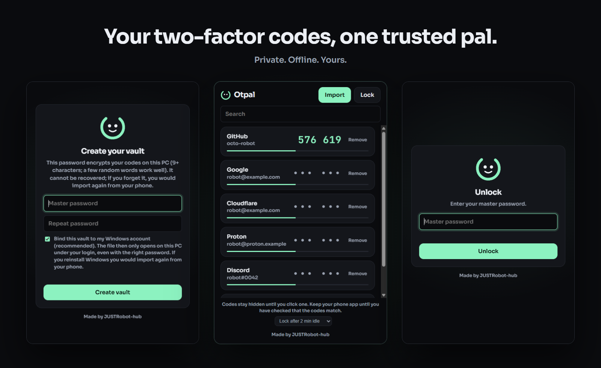
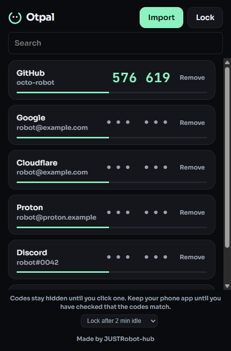

<div align="center">


# Otpal

**Your two-factor codes, one trusted pal.**

Import your Google Authenticator accounts once. Keep them encrypted on your own PC.<br />
No cloud. No account. No tracking.

[](#install)
[](https://tauri.app)
[](#how-your-codes-are-protected)
[](LICENSE)

<br />



</div>

<br />

## Why Otpal?

Google Authenticator keeps your codes on your phone. Lose the phone and you can lose your accounts. Otpal gives you a second, private home for them: a small desktop app that works offline, stores everything in one encrypted file, and never talks to a server.

- **Private by design.** Your secrets never leave your PC. There is no sync, no telemetry and no sign-up.
- **Moves in minutes.** Import straight from Google Authenticator's *Transfer accounts* export. No retyping secrets.
- **Locked down.** A strong master password, optional Windows Hello, and a vault bound to your Windows login.
- **Calm and quick.** Search, click to reveal a code, done. It locks itself when you walk away.

<div align="center">

</div>

## Features

| | |
|---|---|
| **Encrypted vault** | AES-256-GCM, with the key derived by Argon2id (64 MiB, 3 passes). |
| **Bound to your Windows account** | An optional outer layer (DPAPI) means a copied vault file will not open on another PC or user. |
| **Windows Hello** | Unlock with fingerprint, face or PIN, with the master password as fallback. |
| **Codes stay hidden** | Codes show only after you click, then hide again after a few seconds. |
| **Auto-lock** | Locks after 1, 2, 5 or 10 minutes idle, and when Windows locks, sleeps, or the window is minimized. |
| **Three ways to import** | Scan with the webcam, send from your phone over Wi-Fi (end-to-end encrypted), or paste the export text. |
| **Screen-capture protection** | Screenshots and screen recorders see a blank window. |
| **Hardened process** | Other programs cannot read Otpal's memory, and the webview is locked down (no dev tools, no right-click menu). |
| **Secrets live in Rust** | The vault is decrypted and used only in the native backend. The UI receives account names and one code at a time. |
| **Standard TOTP** | RFC 6238 (SHA-1, SHA-256, SHA-512; 6 or 8 digits; any period), compatible with the services you already use. |

## Install

**Portable**: download `otpal.exe` from the [Releases](https://github.com/JUSTRobot-hub/otpal/releases) page and run it. Nothing to install.

**Installer**: download `Otpal_0.1.0_x64-setup.exe` for a normal Start menu install (per-user, no admin rights needed).

Requires Windows 10 or 11 with the WebView2 runtime (already included in Windows 11 and current Windows 10).

**Linux** (experimental): download `Otpal_0.1.0_amd64.AppImage` (`chmod +x`, then run) or `Otpal_0.1.0_amd64.deb` (`sudo apt install ./Otpal_0.1.0_amd64.deb`). The vault is encrypted with your master password. Windows-only extras (Windows account binding, Windows Hello, screen-capture and process protection) are not available on Linux.

## Getting started

1. **Create your vault.** Choose a master password of 9 or more characters. A few random words work well. Otpal cannot recover it, so remember it.
2. **Import your accounts.** On your phone open Google Authenticator, then *Transfer accounts*, *Export accounts*. Pick one way to bring the QR code over:
   - **Webcam**: hold the phone's QR code up to your PC camera.
   - **From phone**: scan Otpal's QR code with your phone, then upload a screenshot of Google's QR code. Everything is encrypted on the phone before it leaves.
   - **Paste**: paste an `otpauth://` or `otpauth-migration://` link.
3. **Check the codes match** your phone for a minute, then retire the old setup when you are happy.
4. **Optional:** turn on Windows Hello in the footer for one-touch unlocking.

> Keep your phone's Google Authenticator until you have confirmed every code matches. Delete the QR screenshot afterwards: it contains your secrets.

## How your codes are protected

```
master password ──► Argon2id ──► AES-256-GCM key ──► vault.json
                                                        │
                      Windows account (DPAPI) ◄─────────┘   optional outer wrap
```

- The vault file is authenticated encryption. Any tampering makes it refuse to open.
- Secrets exist in plain form only in the Rust process, briefly, and are wiped from memory when no longer needed.
- The phone import page is served on your local network for the length of the import dialog only. The decryption key sits in the URL fragment, which browsers never send over the network.
- Windows Hello derives its key from a signature only your device's credential can produce, and stores your master password encrypted with it.

### Honest limits

Otpal raises the bar a lot, but no desktop app can defend against everything:

- Someone who knows your master password **and** can sign in as you can open your vault.
- Malware running as an administrator, or a kernel-level debugger, can defeat process protections.
- A weak master password is the weakest link. Prefer a long passphrase.
- Screen-capture protection and process hardening are best-effort Windows features, not guarantees.

If you lose the master password, the vault cannot be recovered. Import again from your phone.

## FAQ

**Does Otpal send anything over the internet?**
No. The only network use is the optional phone import, which stays on your local Wi-Fi and is encrypted end to end.

**Where is my data stored?**
In one file, `vault.json`, inside your user profile's app data folder (`%APPDATA%\com.otpal.app`). Back it up like any private file.

**Can I use it on another PC?**
If you enabled Windows account binding, the file only opens for the same Windows user on the same PC. Import your accounts again on the new machine.

**Is it a replacement for a hardware key?**
No. It is a convenient, local authenticator. For your most important accounts, add a hardware security key as well.

## Build from source

You need [Node.js](https://nodejs.org), [Rust](https://rustup.rs) and the Tauri 2 prerequisites for Windows.

```bash
npm install
npm test                          # JavaScript tests
cargo test --manifest-path src-tauri/Cargo.toml
npm run tauri dev                 # run the app
npm run tauri build               # portable exe + installer
```

The portable `otpal.exe` and the NSIS installer are written to `src-tauri/target/release` (and `bundle/nsis`).

## Author

Made by **[JUSTRobot-hub](https://github.com/JUSTRobot-hub)**. Issues and ideas are welcome.

## License

Released under the [MIT License](LICENSE).

<div align="center"><sub>Otpal is an independent project and is not affiliated with Google.</sub></div>
